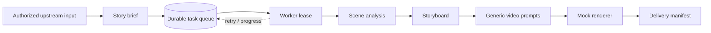

# workflow

**AI Creative Workflow & Worker Orchestration — Privacy-Safe Portfolio Demo**

A fully runnable, clean-room demonstration of a creative production workflow: typed stage contracts, SQLite-backed durable jobs, multi-worker-safe leasing, retries, stage progress, storyboarding, generic video prompts, and a replaceable mock render adapter.

> **This is not the original production repository.** The engineering patterns have been independently reimplemented as an educational portfolio example. The scenes and prompts are synthetic. Rendering outputs JSON task receipts, **not real videos**.

## Quick start

Python 3.10+; no third-party packages, network, or API keys required.

```bash
python -m workflow_demo demo --workspace .local
python -m unittest discover -s tests -v
python scripts/publication_audit.py
```

Demo output appears at `.local/output/<workflow_id>/` with a fictional `prompts.json`, three mock render receipts, and a `delivery.json` manifest. Inspect [`examples/sample_prompt_pack.json`](examples/sample_prompt_pack.json) for the generated prompt structure without running code.

## Workflow



Authorized external systems **can provide source information through corresponding channels**. All such acquisition, downloader, connector, parsing and authorization implementations have been **deliberately omitted**. The demo consumes only an invented brief supplied as JSON.

## Technical highlights

| Capability | Implementation |
|---|---|
| Durable task processing | SQLite queue and `BEGIN IMMEDIATE` claim transactions |
| Reliability | Leases, heartbeat renewal, expired-lease reclaim, bounded retry/backoff |
| Multi-worker safety | Atomic claim; stale completion protection |
| Exactly-once stage scheduling | Unique `(workflow_id, stage)` and atomic completion/next-stage creation |
| Observability | Per-task progress events and workflow status |
| Creative pipeline | Fictional scenes -> storyboard -> generalized video prompts |
| Replaceable render backend | `VideoBackend` Protocol and offline `MockVideoBackend` |
| Safety boundary | No partner or channel data, secrets, production prompts, logs or business logic |

## Code map

- [`workflow_demo/queue.py`](workflow_demo/queue.py) — queue transactions, leases and retries
- [`workflow_demo/worker.py`](workflow_demo/worker.py) — execution loop and failure handling
- [`workflow_demo/pipeline.py`](workflow_demo/pipeline.py) — original generic prompt workflow and mock rendering
- [`tests/test_workflow.py`](tests/test_workflow.py) — concurrency, retry, cancel and end-to-end checks
- [`docs/ARCHITECTURE.md`](docs/ARCHITECTURE.md) — tradeoffs and architecture review
- [`docs/SECURITY.md`](docs/SECURITY.md) — removed data categories and publication checklist

## For engineering interviews

This illustrates experience with AI content tool orchestration, worker systems, failure recovery, and storyboard/prompt automation. It does **not** claim to benchmark the original system's performance or publish any original company intellectual property.

**Publication note:** Automatically removing names does not make employer-owned intellectual property safe to publish. This repo is independently written; review the rights to any future additions before publishing. No open-source license is granted by default.
